# Customer activation and service architecture

Architect: software architect. Recorded October 22, 2026 UTC, against the local `bb8d515` baseline. The baseline audit and implementation contract below are historical source evidence; the dated publication disposition at the end records the subsequent bounded release. Provider approval and live service acceptance remain separate. [SELF-SERVICE.md](SELF-SERVICE.md) owns product priorities; QA owns independent journey acceptance. The baseline audit used source and synthetic local checks only.

## Decision and first delivery

Routine setup must work without Steve. Customers still supply their business facts, verify their email, authorize their calendar, accept applicable provider declarations and configure their own phone forwarding. The platform must carry each subsequent operation to an observable result. A customer action is not an internal operator task; a carrier review is not something automation can approve on the carrier's behalf.

The first implementation closes an account takeover before expanding the setup flow. At baseline, anonymous `POST /api/onboard` looks up an email, overwrites the matching shop and returns its existing private owner key. Email knowledge is being treated as authority. The replacement requires mailbox proof, supports legitimate recovery and makes repeated creation resumable. It then gives the owner honest setup progress and a contextual tutorial. Autonomous purchases remain gated until provisioning has durable, recoverable side-effect receipts.

This delivery has four boundaries:

1. Verified email access, private recovery and one resumable tenant per verified owner email.
2. Durable account/build progress with safe retries and an explicit failed or needs-attention result.
3. Server-derived readiness and channel-specific activation; missing SMS or voice cannot be presented as live.
4. A replayable owner walkthrough that completes useful setup tasks and does not itself mark providers verified.

Implementation handoff: the architect also built the narrow owner-test isolation prototype in `netlify/functions/lib/owner-test.mjs` and the client-mode branch of `chat.mjs`, with root's explicit assignment. `scripts/owner-test-check.mjs` records 37 focused local assertions in `scratchpad/owner-test-isolation-final.json`: matching real customer records/capacity stay unchanged, emergency previews create no escalation, failed/stale tests cannot certify new rules, and test history is separate. These are fake-model/memory results with zero outbound requests, not actual inference or independent acceptance. QA and engineering must review this prototype independently; the architect cannot accept their own implementation.

### Implementation review checkpoint

The local first slice now creates a versioned draft directly from the verified owner's saved answers. It does **not** dispatch a crawler/model build: background import and paid provisioning reject new self-service tenants before external work. That bounded implementation removes the need for an unreliable background trigger for this initial draft. Durable asynchronous import/provisioning below remains target work, not an implemented queue.

Architecture review returned two concrete issues beyond the original baseline: a stale open portal form could overwrite newer saved rules because no browser revision was submitted, and actual customer web tools still scheduled Calendar/reminder/escalation work and stamped SMS consent despite inactive channels. Root added an expected configuration revision to portal saves and server validation; independent acceptance must cover the final version.

Root separately assigned the architect the narrow record-only delivery correction in `lib/desk.mjs`. New self-service customer web bookings and leads keep real portal records/capacity with `delivery.mode=portal_only` and unconfirmed human contact. They create no Calendar events, reminder/follow-up/escalation jobs, generated SMS consent or owner/customer communication. Previously queued callback/escalation work exits before side effects. `scripts/self-service-delivery-check.mjs` records **32 focused local checks** in `scratchpad/self-service-delivery-first.json`, at desk source SHA `df013897567a1ef8446d58838d437ecef8a38fb75c947db93282938c73e918b7`: new tenants make zero outbound attempts and zero tasks, while the legacy control preserves reminder/consent behavior through three intercepted adapter requests. QA independently accepted the actual `/api/chat` route through installed-SDK protocol fixtures and real desk/store behavior in **19 checks**, `scratchpad/customer-web-delivery-qa.json`, with that exact desk hash stable. Its six model HTTP fixtures are intercepted; this establishes wiring and side-effect boundaries, not actual model quality or provider delivery.

The access source review found no remaining blocker in its mailbox-proof, token/session expiry, trusted-origin, private draft or account-projection boundary. Earlier malformed-expiry and streamed test-metadata returns are addressed in source. Review returned the initial logout boundary: signing out of onboarding left a persistent portal URL usable. **The new-tenant migration is now implemented and source-reviewed**, against `scratchpad/customer-platform-session-backend-frozen.json`: verified 24-hour sessions gate owner APIs, private tests, status and exports; old URL keys cannot authorize new tenants; c-only portal links and owner responses omit those keys. Explicit invalid/expired/revoked credentials return authentication errors, foreign mailbox authority is rejected, and private/public views are not shared-cacheable. Calendar and billing return unavailable before provider or plan actions. Sign out revokes subsequent owner requests; an already-authorized invocation may finish. Independent final revocation/browser acceptance and real email/live-service proof remain separate. Legacy URL-key/OAuth compatibility applies only to unmarked shops.

Engineering review returned a defensive reschedule path beyond the original real-web correction. The final `lib/desk.mjs` guard preserves a portal capacity move without Calendar updates, reminder tasks or owner sends, including a stale remote event ID. **36 local checks** pass in `scratchpad/self-service-delivery-reschedule-final.json`, desk SHA `a0e35e861e8b5e89b60168287022f64aa80c7b6c1539111ebe76a14d52a8de48`. The earlier independent 19-case route proof above describes its recorded prior source; final provenance/independent confirmation must bridge this small addition rather than relabel the earlier run.

Engineering independently reviewed and reran that final desk correction: **36 passing checks** at the same hash in `scratchpad/engineer-self-service-delivery-review.json`. No actual provider request occurred.

Root also assigned the architect the legacy scheduler/fanout boundary. New tenants are excluded from legacy delivery tasks, carrier polling, founder/commercial lifecycle messages, phone-service health alerts, paid-resource release and daily/audit/weekly/monthly fanouts. Ordinary portal records are retained; historical unavailable tasks receive honest skip receipts, not send or invoice outcomes. **55 local checks** in `scratchpad/self-service-scheduler-first.txt` force every legacy gate with synthetic tenants: zero new-tenant outbound requests, 13 skipped task types, unchanged customer/resource records and health 200; legacy controls preserve nine intercepted HTTP adapter requests. The existing configured-key ten-case scheduler gate also passes in `scratchpad/self-service-scheduler-legacy-gate.txt`. Scheduler SHA `cd7576566e59adab029885ac0c8af9837049f8611b372d0ea50c23977d5bd8a8`, fanout SHA `7c6fbacfd4fa724974f506bd8331dfb3b91a7093dda2e27295bc112f01c8be46`. These architect-authored changes require independent review; no live network or automatic emails were exercised.

Engineering subsequently independently accepted that source and reran **55 passing checks** at the same hashes in `scratchpad/engineer-self-service-scheduler-review.txt`; its provider adapters are intercepted, with zero real requests. Final portal/PO acceptance remains separate.

Architecture returned the unlimited free-owner test path as a release blocker. **That blocker is now addressed locally:** `lib/self-service-ai.mjs` reserves a shared strict CAS allowance before new-tenant private tests or public chat can invoke the model or write conversation/test history. Defaults are 20 private turns per tenant, 50 customer turns per tenant, and 50 combined turns globally per Houston day. `MC_SELF_SERVICE_AI_GLOBAL_DAILY_LIMIT` accepts an operator value from 0 to 500; zero disables new starts and malformed configuration fails closed. Both modes share one document, compute the day inside each CAS retry, retain failed/ambiguous attempted starts, and expose only the requesting owner's allowance. New owner/admin authority cannot bypass it. Exhaustion blocks activation and public availability; settings and existing portal records remain accessible.

The architect independently accepted the implementation and reran **43 checks**, `scratchpad/architect-self-service-ai-review.txt`, using memory plus the installed Blobs SDK protocol double, 6,652 conditional conflicts, retry-time midnight/DST cases and injected model/storage failures. Zero actual external requests occurred. The unit is an accepted logical turn; the existing agent loop and SDK retry limits bound its internal requests. It is **not a dollar cap**, an actual inference result, or a new allowance for legacy/homepage modes. Final receipt: `scratchpad/architect-budget-package-review.json`, matching the unchanged 25-file `customer-platform-budget-frozen.json` source map.

The same independent read review accepts the new static publishing boundary: Netlify publishes `dist`, while function source remains in `netlify/functions`. The packager copies browser HTML/CSS, explicit entry scripts/configuration and the public assets tree, checks local HTML dependencies and source/output hashes, and excludes credentials, product/business instructions, test evidence, scripts, packages and function source. The current package has **217 browser files and 182 HTML pages**, with every current source/output hash matching, no forbidden private entries and no symlinks. This records the local package/configuration proof at that review. The subsequent separately approved publication and bounded route/header checks are recorded in the dated disposition below; live authenticated state transitions and service delivery remain unverified.

Billing stays parked. Trial/card claims cannot be fulfilled by collecting a plan choice; the future payment decision must be explicit. This contract authorizes implementation and local tests, not a deployment, number purchase, carrier filing, delivered email, model request or provider pass.

## Baseline: what actually exists

| Journey | Actual baseline source | Consequence |
|---|---|---|
| Signup | `onboard.html`, `onboard.mjs` | Five questionnaire steps, no account verification, no durable browser resume. Existing email is an unauthenticated overwrite/key-disclosure path. |
| Build | `onboard-build-background.mjs` | Best-effort HTTP trigger; crawler and model merge a whole client snapshot. Duplicate invocation has no durable ownership. Catch sets `status=testing` even when the build fails. |
| Website import | Same build function, `fetchPage`/`crawl` | Arbitrary submitted URL, followed redirects and discovered links receive server fetches. No explicit public-address/DNS/redirect boundary; an untrusted owner website is also an untrusted prompt source. |
| Provisioning | `provision-background.mjs`, `lib/twilio.mjs`, `lib/vapi.mjs` | Automatic build follow-on can buy a number, create services/file A2P and create an assistant. Whole-run `steps={}` reset, no CAS operation claim, no receipt at every external creation. Overlap or lost responses can duplicate resources/fees. |
| Owner access | `desk.html`, `client.mjs`, `lib/config.mjs` | Persistent bearer `?c=&k=` private link. An invalid key falls through to the public widget view; the portal assumes owner data and can crash. No expiry/revocation or team roles. |
| Activation | `client.mjs` `go_live`/`resume`; setup checklist in `desk.html` | Status becomes live without a build, provider or service-rule gate. The UI claims texting is answering and hardcodes the built check. Keys alone do not prove delivery. |
| Owner test | `chat.mjs` client mode, `lib/desk.mjs` `bookVisit`/`flagLead` | The `test` channel uses real capacity, booking/lead stores, Calendar writes, confirmation texts, alerts and follow-up tasks. It can also merge a test contact into a real recent lead. Tutorial test data is not isolated at baseline. |
| Public pre-live access | `chat.mjs` client mode, `embed.js` | Nonowners can use a `testing` shop, so gating the Go live button alone does not enforce customer activation. |
| Calendar | `google.mjs`, `lib/calendar.mjs` | Owner authorization exists, but OAuth `state` encodes the reusable owner key. No single-use nonce/expiry. Local capacity does not read calendar busy time. Remote cancellation/repair remains open. |
| Delivery | `lib/desk.mjs`, `scheduler.mjs`, `lib/send.mjs` | Booking/lead tools, reminders, escalation, digests and follow-ups exist. Interrupted capacity writes are deliberately retained, but reminder failure is not a durable retry/attention workflow. |
| Human operations | `OPERATIONS.md`, first-customer section | Steve must currently review each setup, consent, forwarding, first cases, conversations, day-seven message and invoice. There is no current evidence of a fully autonomous accepted customer journey. |

The booking capacity CAS and retained mutation tokens are useful existing foundations. Preserve their fail-closed semantics. The general `store.get()` swallows read errors into `null`; identity, operation claims and readiness cannot use that as proof that no record exists.

## Target customer lifecycle

```mermaid
flowchart LR
  A[Verify email] --> B[Save and resume shop setup]
  B --> C[Build draft from owner facts]
  C --> D[Review rules and try the desk]
  D --> E[Authorize selected channels]
  E --> F[Automated setup and provider review]
  F --> G[Prove each selected channel]
  G --> H[Activate ready channels]
  H --> I[Operate and monitor]
  I --> J[Pause, recover or cancel]
```

Knowledge review and channel setup can proceed independently. Website chat need not wait for a carrier's SMS review. Phone must not advertise SMS fallback until an approved sender and actual path exist. A setup page shows, per step, **done**, **your action**, **working**, **waiting for provider**, **retry scheduled**, or **needs attention**, plus the next useful action. None of those is inferred from elapsed time.

Keep lifecycle dimensions separate: `account`, `knowledge`, `channels.web`, `channels.voice`, `channels.sms`, `calendar`, `deliveryHealth` and `commercial`. A single shop `status` remains a compatibility summary, not the authority for every integration. A paused/cancelled shop can never be reactivated by a late build or provisioning callback.

## Identity and tenant boundary: first-slice API

`POST /api/access {action:"request_link", email}` validates and normalizes email, applies strict per-recipient and per-IP rate limits, and returns the same generic response for an existing and a new account. It sends only a fixed trusted HTTPS URL `/onboard#verify=<token>`; neither raw token nor private tenant/portal details appear in the response. Production email unavailable/rejected is an explicit recoverable delivery error, not “sent.” The only outbox fixture is private to an isolated local memory test.

`POST /api/access {action:"exchange", token}` atomically consumes a cryptographically random challenge, stored by its hash and expiring after 20 minutes. A successful exchange issues an independent, random verified session; store only its hash, verified email, expiry and allowed scope. Session lifetime is 24 hours. The implementation's `onboarding` scope authorizes setup and, after tenant creation, owner operations only for that same verified mailbox; it never grants admin or provider-setup authority. The browser removes the fragment from history; a link GET alone does not consume the challenge. All responses are `no-store`, with `no-referrer` on the access page. A used, expired or unknown link returns the same recoverable link error. Requesting a link never changes a customer's existing account.

`POST /api/onboard` requires `Authorization: Bearer <verified-session>`. Email derives from the session. A conflicting body email is rejected. No session is an authentication failure, including an already-existing email. A verified existing owner resumes the private existing tenant; a new questionnaire submission does not overwrite its rules or restart provisioning. Owner edits, private tests, status and exports require that revocable session on new tenants. Recovery is delivered through the same mailbox flow; no Steve action is required for routine lost-link recovery.

This design follows the relevant recovery guidance on random, expiring, single-use tokens, consistent account responses and trusted link construction in [OWASP's primary guidance](https://cheatsheetseries.owasp.org/cheatsheets/Forgot_Password_Cheat_Sheet.html). It does not assert that mailbox control provides stronger assurance than mailbox control.

The existing owner bearer link remains a compatibility surface for unmarked legacy shops only. New tenants use c-only URLs and the revocable verified session, held in browser session storage and sent in `Authorization`; Sign out revokes the current session and clears visible owner state. A later hardening step can move that browser authority to Secure, HttpOnly, SameSite cookies and migrate legacy OAuth state. Never copy owner credentials into tutorials, analytics, logs, cross-origin referrers or public embed code. Public widget views remain explicitly separate from owner responses; explicitly supplied invalid owner credentials must fail as owner access, not masquerade as the public widget.

## Race-safe account creation contract

Proposed helper: `ensureVerifiedAccount({email, initialClient, submissionHash}) -> {created|resumed|existing, client}`. The interface is the architect's contract; the engineering receipt must name the implemented equivalent.

1. Use a strict-read/CAS `accounts/<sha256(normalized-email)>` registry. During migration, strict-read the legacy email index/client and adopt an existing matching tenant. A storage failure is not absence. Never overwrite another slug mapping.
2. First creation reserves a stable slug, owner key, canonical initial client snapshot and submission hash in one CAS write. Do not persist raw access/session tokens. CAS callbacks contain no sends, provider calls or logs because conflicts replay the callback.
3. Create the client projection with conditional-create semantics. If it already exists, require the reserved identity to match and preserve its current fields. Never replay the initial snapshot over owner changes or later build results.
4. Repair the legacy email index only if absent or equal to that slug. Mark projection complete last. A retry after a partial write uses the original reservation and repairs only missing projections. It never generates another shop or credential.
5. While creation is pending, changed submission data returns a conflict requiring reload/review. Once created, returning to onboarding resumes that shop, not a second create. Configuration edits have their own revision-checked endpoint.

Acceptance must include concurrent sessions for the same mailbox, a lost response after each storage write, conflict retries, storage errors and an owner edit between initial projection and retry. If a create write is ambiguous, retain the reservation. A timeout alone never proves it is safe to create a different account.

## Durable setup and service operations

Each operation has its own private record, e.g. `setup/<slug>/<operation-id>`, with `kind`, input/config revision, dependencies, authorization/consent revision, status, attempt count, next-attempt time, idempotency key, current claim and sanitized receipts. Use statuses `queued`, `running`, `succeeded`, `waiting_customer`, `waiting_provider`, `retry_due`, `uncertain`, `failed` and `cancelled`. Record provider request IDs/resource IDs before dependent work proceeds. The owner view exposes useful progress, not credentials or raw provider responses.

The scheduler recovers queued work and known retryable failures; a successful HTTP background trigger is merely a delivery hint. Step transitions are CAS-claimed, with completion conditional on the same claim and input revision. Concurrent invocations do not run the same side effect. Whole client snapshots are not operation locks: add an atomic client patch/revision helper and preserve unrelated owner/calendar/provider fields.

| Operation | Dependency and completion evidence | Safe recovery |
|---|---|---|
| Knowledge draft | Verified owner setup, selected source facts; built receipt at configuration revision | Retry read-only fetch/model work with capped attempts. Merge only against current owner facts; retain their changes. Failure keeps an explicit draft/retry state, not a built check. |
| Number reservation | Owner selected phone, accepted applicable charges/authority, platform purchasing gate enabled | Stable provider correlation and one durable intent before purchase. Reconcile a lost response against provider resources; never buy a second number because an ID was not saved locally. |
| Messaging/A2P | Existing number/service, complete business facts and customer declaration | Persist each profile/product/brand/campaign ID separately. Poll existing IDs. A provider rejection returns the exact customer correction; ambiguous creation waits for reconciliation. |
| Voice assistant/import | Current reviewed configuration, number, validated destinations | Persist assistant ID before import. Reconcile each creation/update independently. Never attach a cancelled/paused shop or send calls back into its forwarded line. |
| Calendar connection | Customer OAuth | Single-use random state stored server-side with expiry and tenant binding; no owner key in state. Preserve a prior refresh token if Google omits a new one. Reauthorize failures through the customer. |
| Welcome/notifications | Verified destination and selected channel actually available | Durable notification intent and outcome; distinguish logged, accepted and delivered. Do not claim completion from a locally logged send. |
| Ongoing reminders/follow-up | Current consent, booking/task still applicable, quiet hours, shop active | Atomically claim; recheck prerequisites at execution. Retry only known-safe outcomes; retain uncertain attempts and failed work. Do not delete the only task record on failure. |
| Cancellation | Authenticated customer intent | Stop new work immediately, retain already-accepted obligations, reconcile remote calendar/voice/number resources with receipts. Do not reopen from a delayed completion. |

Exactly-once execution is not assumed across Blobs and an external provider. Use provider idempotency where the exact endpoint supports it; otherwise use correlation plus reconciliation. Do not invent an idempotency header and assume it works. Claims for irreversible work do not expire into automatic re-execution after an uncertain response. Any operator reconciliation first establishes that the previous writer cannot resume; existing booking recovery guidance remains authoritative.

Provider creation remains disabled for the new self-service path until those receipts, cost/consent gates and controlled-provider acceptance exist. Verified email alone is not permission to spend against the platform's Twilio account. That platform gate is configured once for the accepted product; it must not become Steve approving every ordinary customer after launch.

## Website import and untrusted content

Website import is optional; a complete owner questionnaire can create a useful draft without it. Before automatic crawling, require an HTTP(S) public host, reject credentials and nonstandard schemes, restrict ports, resolve and reject loopback/private/link-local/multicast/metadata destinations for both IPv4 and IPv6, and validate every redirect and discovered URL. Protect against DNS rebinding with a transport that connects to the validated address; a string blacklist alone is insufficient. Cap bytes, duration, redirects and pages. If the transport cannot enforce that boundary, skip automatic import with a clear owner action instead of issuing the unsafe request.

Website text is untrusted evidence, never an instruction to call tools, reveal credentials or change safety rules. Import produces a versioned candidate with source URLs and conflicts; owner answers win. Unknown facts remain unknown. No imported text is allowed to claim consent, phone ownership or a completed provider check.

## Derived readiness and activation

One shared server function calculates readiness from persisted facts and current platform capability. The portal renders its result; activation calls the same function immediately before changing state. Customer-supplied `ready`, tutorial completion and client-side checks have no authority. Return specific blockers, a next action and a destination within the portal.

| Capability | Minimum authority and readiness |
|---|---|
| Private test | Verified owner/session, usable draft from owner facts; explicitly isolated test contact/channel. |
| Website chat | Reviewed current business facts, explicit service area/hours and booking policy, safety/handoff destination, successful owner test and customer activation intent. Model/operational dependencies available. Website installation is a separate proof, not presumed from a live status. |
| Voice | Web/service rules plus existing assistant/number, validated fallback/transfer destinations, applicable customer acceptance, observed inbound/forwarding test and provider path. No voice readiness from API-key presence alone. |
| SMS | Eligible approved own sender or actually approved bridge sender, recorded consent/policy version, verified recipient/opt-out flow and observed controlled send/delivery. A bridge brand still in review cannot satisfy the gate. |
| Calendar | Customer connection and observed selected-calendar write/repair behavior. Optional unless the chosen service promises Calendar scheduling; token presence is only connection status. |
| Spanish | Customer enables it plus the named-shop language/safety review gate. Selecting Spanish in a tutorial is not a human review. |

The first implementation may deliver web-only activation with explicit disabled phone/SMS states. It must not announce universal service readiness. Missing optional review-link or calendar setup cannot block unrelated web operation; missing selected-channel prerequisites must block that channel. The owner can save progress and return without losing facts or repeating paid setup.

## Walkthrough and everyday owner experience

The tutorial is a small persistent task sequence in the real portal, not a marketing carousel: review what the desk knows, run a test question, inspect the resulting request, learn acknowledgment versus completed contact, set one availability block, choose/setup channels, inspect readiness and pause/resume. Each step explains what it does and opens the corresponding working tab/control. Mobile keyboard/focus behavior and errors are part of acceptance.

Store versioned progress per tenant/owner. Skip closes the walkthrough without claiming completion; Resume/Replay always exists. Mark real task completion from saved state or observed server events, not a Next click. Tutorial examples and test requests are labeled and isolated from real customer reminders/dispatch. No animation, sample data or successful button click can satisfy a provider gate. First use opens the relevant setup action; returning owners land on their useful work queue.

## Observability and ownership

Use one correlation ID from verified signup through setup and service operations. Retain state transitions, sanitized errors, attempt counts and provider receipt identifiers. Redact tokens, keys, customer free text and EINs from general logs. Show customer-facing pending/failed work on the portal and an exception queue to Operations; do not make routine success depend on Steve reading email.

PO accepts the customer outcome and prioritizes missing requirements. Architect owns boundaries and consistency. PM owns dependencies, a bounded implementation/release plan and evidence stage. Engineer implements/reconciles. QA independently attacks the full journey and reports failures without approving its own code. Operations owns retry policy, exception triage, recovery runbooks and service health. These roles do not replace a real customer, carrier or provider approving its own reserved step.

## Observable acceptance for the first slice

- Anonymous knowledge of an existing owner email cannot read or mutate any private account, return its key, change status or trigger build/provisioning. Expired/used/wrong tokens and foreign sessions fail closed without owner data.
- Fresh email proof reaches one durable shop; lost responses, simultaneous submissions and reloads resume it. An existing owner recovers their original portal without overwriting business rules. Email delivery failure is visible and retriable. Local outbox proof is not real inbox delivery.
- Website-free setup works. Any website import used by the slice meets the public-address boundary, or is explicitly skipped without fetching it.
- A queued build survives a missed trigger through durable recovery. A failed build is shown as failed/retryable, never “built” or “live.” Retry does not erase owner edits, calendar state or provider receipts. Paused/cancelled shops stay so.
- Owner test inputs cannot consume real capacity, merge into actual customer leads, write Calendar events, schedule reminders/escalation or notify anyone. Labeled test previews use a separate sandbox boundary; the model's `channel` string is not sufficient isolation. Public website chat remains unavailable before explicit accepted web activation.
- Go live/resume rechecks authoritative readiness, preserves the previous state on failure and names remaining actions. Phone/SMS unavailability never produces a message claiming they answer or deliver. No unknown sender approval is treated as live.
- At 390 px and by keyboard, the owner can verify/access, finish setup, leave/recover, follow the walkthrough, run an isolated test, inspect the owner result and locate real readiness. A rejected/offline save or action never shows success.
- Parallel/background cases use memory and installed-SDK CAS doubles with fault injection; production provider credentials remain stripped and all outbound fetches are guarded. QA retains before/failure evidence plus exact accepted source hashes.

Local, committed, deployed, real-email, provider, live-store and first-customer acceptance are distinct stages. Until independent QA and PO record the implemented scope and evidence, these bullets are requirements, not passed checks. The existing first-shop provider matrix and first-week gate remain open.

## Sequence after this slice

1. Prove durable provisioning against controlled provider resources, including ambiguous writes and cleanup, then enable routine purchases within explicit platform limits. Obtain real email delivery and live-store concurrency acceptance.
2. Complete legacy owner-key/OAuth-state migration and harden browser session storage; new self-service owner access already uses revocable sessions. Add versioned consent and team invitations/roles only with tenant-bound authority and independent tests.
3. Complete retained reminder failures, calendar cancellation/repair and honest callback completion before declaring automated service delivery accepted.
4. Obtain a named-shop end-to-end gate and customer week. Replace mandatory founder review with instrumented automatic checks and an Operations exception path; do not delete a safety gate merely to remove a human step.
5. Reconcile public plan/trial claims with the explicitly approved commercial lifecycle. Billing remains parked until that decision; no first-slice payment activation is implied.

## October 21, 11:14 p.m. Houston: publication disposition

The [publication receipt](../scratchpad/customer-platform-publication-b65.json) confirms exact approved `b65c0f4fef06d8f4e44e2a04101698034bd14842` at READY deploy `6ad98d7be2a7b05658217178`, published `2026-10-22T04:14:20.228Z`, one automatic build and no manual trigger. This supersedes the baseline/prepublication production pointer without changing the historical source reviews above. Later sales-chatbot work was excluded.

[Bounded hosted evidence](../scratchpad/customer-platform-hosted-b65-final-disposition.json) covers 25 GETs, 12 exact approved asset hashes, five absent private paths, clean signup route 200 and one health 200/ok with natural scheduler `04:10:18.616Z`. Captured deployed HTML and hash-verified assets render signup/owner gates and mobile menu in system Chrome with actual browser network denied. Raw unavailable-Chromium, literal-href and expected-redirect harness returns remain preserved with their scoped dispositions; this is not a new full customer-journey pass.

The deployment does not establish delivered verification email, completed live signup, live Blobs correctness/revocation, actual private/customer AI replies, installed customer-site exchange or autonomous phone/SMS/Calendar delivery. The demo callback-prompt correction is published but actual-model compliance was not rerun. Those operational contracts and acceptance gates remain open; the spent one-build/read-only scope grants no further release, purchase or model/provider phase.
